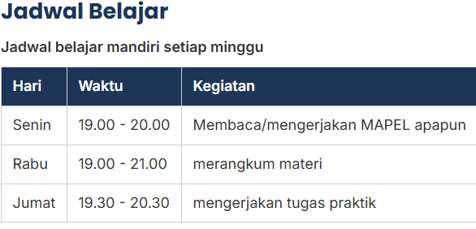

# Portofolio Pelajar

Website portofolio pribadi yang berisi profil, jadwal belajar, hobi, cita-cita, keahlian, dan proyek yang telah saya buat.

## Tampilan

## Fitur

- Halaman beranda berisi profil pribadi.
- Halaman tentang saya.
- Halaman jadwal pelajaran.
- Halaman kontak untuk menghubungi saya.
- Tampilan responsif yang dapat dibuka melalui komputer maupun ponsel.

## Teknologi

- HTML5
- CSS3
- JavaScript

## Tautan

- [Halaman Website](https://username.github.io/nama-repository/)
- [Repositori GitHub](https://github.com/username/nama-repository)

